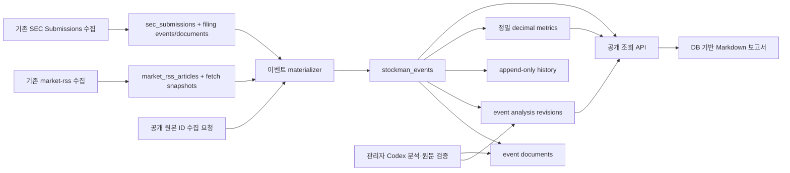

# Stockman SEC·RSS 이벤트 관리 아키텍처

## 목적과 경계

기존 `market_rss_articles`, `sec_submissions`, `sec_filing_events`와 원문 archive를 source of record로 유지하면서 장기 이벤트 ID, source document 연결, 분석 revision과 변경 이력을 추가한다. 새 ledger는 원문/기존 분석 데이터를 대체하지 않는다.

## 데이터·검증 흐름

- 기존 RSS/SEC cron이 source rows를 먼저 저장한다. 그 다음 별도 best-effort materializer가 기존 기록을 ledger에 멱등 연결한다. ledger 실패는 원래 수집·알림 결과를 롤백하지 않고 cron 결과를 degraded로 남긴다.
- SEC cron은 추가로 SEC_EDGAR RSS 중 SEC 제출 테이블에 아직 없는 accession을 최대 10 CIK/실행(환경값 상한 50) 찾아 기존 `syncSecCompany`로 정식 Submissions metadata를 보강한다. 후보는 활성 미국 COMMON_STOCK 마스터와 매칭되는 RSS ticker만 포함하고 기존 설정 CIK와 중복 호출하지 않는다. RSS 후보 보강 경로는 Submissions metadata만 동기화하고 XBRL/회사 전체 원문 수집은 명시 설정 CIK에 한정한다.
- SEC는 `(CIK, accession)`에서 안정 identity를 만든다. `acceptance_datetime`의 14자리 Eastern Time wall clock을 UTC instant로 변환하며, 티커는 SEC 회사 ticker 목록과 활성 `us_common_stock_universe` 보통주/미국 거래소 마스터가 모두 확인될 때만 처리한다.
- RSS는 `(source, external_id)`로 event/document를 멱등 연결한다. RSS가 제공한 ticker가 활성 common-stock master와 일치해도 그 사실만으로 원문을 공식 검증하지 않는다. RSS source documents는 기본 `UNVERIFIED`다.
- 관리자는 `/api/admin/events/{id}/analysis`에 Codex 분석과 원문 문서 ID를 제출한다. 긍정 등급은 HTTPS 원문, 티커, 활성 보통주 마스터, evidence quote와 문서 검토가 모두 있어야 저장/검증된다. 등급 재평가는 hash가 다른 새 revision으로 저장한다.
- SEC Codex queue의 `POSITIVE` 결과는 1차 구현에서 C 후보로 저장한다. 원문 evidence가 비어 있거나 다른 판정이면 `EXCLUDED`다. A/B 등급과 정량 검토는 운영자가 공식 원문으로 확인해 별도 revision을 추가한다.
- 최근/일간 호재 보고서는 `verification_status=VERIFIED`이고 최신 분석 등급이 A/B/C인 이벤트만 포함한다. 종목별 이력 및 희석위험 보고서는 검증/분석 상태를 그대로 표시한다. 시간창은 보관기간이 아니라 `accepted_at`(SEC) 또는 `published_at`(뉴스)에 적용한다. 수집 상태 보고서는 기존 automation run 저장값을 이용한다.
- 조회 GET은 인증 없이 공개하며 원문 payload, 내부 실패 상세, 사용자/관리자 데이터는 반환하지 않는다. `POST /api/events/collect`도 인증 없이 호출할 수 있지만 기존 SEC/RSS source row의 키만 받아 해당 1건을 materialize하고 임의 event field/분석 입력은 거부한다. 공유 write rate limit을 적용한다. 분석 검토·수정 endpoint는 운영자 전용이다.

## 장애 및 재실행

각 source pipeline의 기존 성공 여부와 event materializer 결과를 구별한다. source fetch/parse/store 실패는 새 이벤트 0건으로 처리하지 않는다. ledger는 unique identity 및 `(source, external_id)`와 revision hash로 반복 수집을 견딘다. `stockman_event_history`와 분석/metric revision은 새 행을 추가하고 기존 내용을 지우지 않는다. migration 적용 전 route/cron을 실행하지 않으며 migration 자동 적용 로직은 추가하지 않는다.

관련 구현: `lib/stockman-events.ts`, `db/migration/V166__stockman_event_ledger.sql`, `app/api/events/`, `app/api/reports/`, `app/api/collection-status/`, `app/api/admin/events/`.
