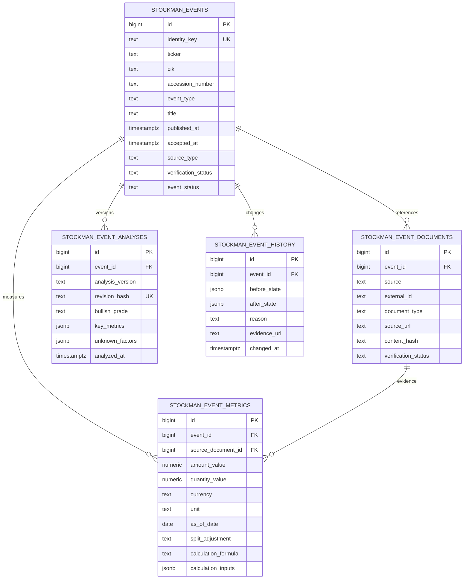

# Stockman SEC·RSS 이벤트 데이터 모델

Migration: `db/migration/V166__stockman_event_ledger.sql`. 모든 시각은 PostgreSQL `TIMESTAMPTZ` UTC instant로 저장하고 보고서에서 KST로 표시한다. 금액·주식 수는 `NUMERIC(38,12)`로 저장하며 API/입력에서 십진 문자열을 사용한다. 값 미공개는 null로 둔다.

## 키와 불변성

- SEC 이벤트 자연키: `SEC:{10자리 CIK}:{accession}`. SEC source document의 `(source, external_id)`도 unique다.
- RSS/issuer article event 자연키: `RSS:{source}:{external_id}`. 기존 `market_rss_articles`의 unique source key와 이어진다.
- event/document는 1:N이므로 후속 원문이 확인되면 동일 이벤트에 새 document를 연결할 수 있다. 자동 후속 이벤트 합치기 기준이 불명확하면 별도 event로 두고 수동 review로 연결한다.
- 분석은 `(event_id, revision_hash)` unique로 보존한다. metric은 `(event_id, metric_key, revision_hash)` unique로 계산 입력 revision을 보존한다.
- History는 현재 작업에서 INSERT만 사용한다. 관련 원문/status 변경은 이전/이후 JSON과 근거 URL을 기록한다.
- 검증 상태는 `UNVERIFIED`, `VERIFIED`, `REJECTED`; 이벤트 상태는 `ANNOUNCED`, `PLANNED`, `COMPLETED`, `CANCELLED`; 호재 등급은 `A`, `B`, `C`, `EXCLUDED`다.
- 기존 RSS/SEC 테이블의 double 금액, source payload, 분석은 변경·삭제·대량 backfill하지 않는다. 새로운 ledger backfill은 별도 dry-run/reconciliation 설계가 선행돼야 한다.
